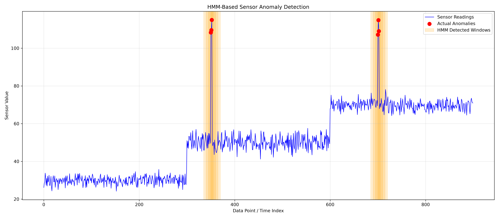
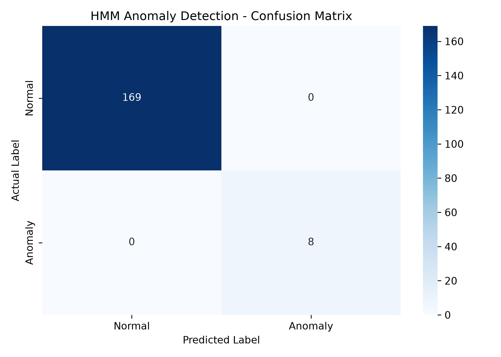

# HMM-Based Sensor Anomaly Detection

## Project Overview

This project implements a sensor anomaly detection system using a **Gaussian Hidden Markov Model (HMM)** in Python.

The system learns normal sensor behaviour from training data and identifies unusual patterns in test data using log-likelihood scores and a detection threshold.

## Objectives

- Learn normal sensor behaviour using a Gaussian HMM.
- Identify unusual sensor patterns.
- Detect anomalies using sliding-window analysis.
- Evaluate the model using performance metrics.
- Visualise sensor readings and detected anomalies.

## Technologies Used

- Python
- NumPy
- Pandas
- Matplotlib
- Seaborn
- Gaussian Hidden Markov Model (HMM)

## Project Features

1. **Data Generation:** Creates normal and test sensor datasets.
2. **HMM Training:** Trains a Gaussian HMM to learn normal sensor patterns.
3. **Anomaly Detection:** Uses log-likelihood scores to identify unusual sensor behaviour.
4. **Model Evaluation:** Calculates accuracy, precision, recall, and F1-score.
5. **Data Visualisation:** Displays sensor readings and detected anomalies.
6. **Confusion Matrix:** Visualises the classification results.

## Project Structure

```text
HMM-Anomaly-Detection/
│
├── data/
│   ├── normal_sensor_data.csv
│   ├── test_sensor_data.csv
│   ├── detection_results.csv
│   └── evaluation_results.csv
│
├── models/
│   └── hmm_model.pkl
│
├── generate_data.py
├── train.py
├── detect.py
├── evaluate.py
├── save_evaluation.py
├── visualize.py
├── visualize_data.py
├── confusion_matrix.py
├── inspect_data.py
├── inspect_model.py
│
├── anomaly_detection_visualization.png
├── confusion_matrix.png
└── README.md
```

## How It Works

1. Generate normal sensor data.
2. Train the Gaussian HMM using normal sensor readings.
3. Load the test dataset.
4. Divide sensor readings into sliding windows.
5. Calculate log-likelihood scores for each window.
6. Compare the scores with the detection threshold.
7. Classify unusual windows as anomalies.
8. Evaluate and visualise the results.

## Model Evaluation

The model was evaluated on the generated test dataset using 177 sliding windows.

| Metric | Result |
|---|---:|
| Total Windows | 177 |
| True Positives | 8 |
| True Negatives | 169 |
| False Positives | 0 |
| False Negatives | 0 |
| Accuracy | 100% |
| Precision | 100% |
| Recall | 100% |
| F1-Score | 100% |

*Note: These evaluation results are based on the current synthetic test dataset and window-level classification.*

## Visualisations

### Anomaly Detection Visualization



### Confusion Matrix



## How to Run the Project

1. Clone the repository:

```bash
git clone https://github.com/divyanka22/HMM-Anomaly-Detection.git
```

2. Open the project folder.

3. Install the required Python libraries used by the project.

4. Run the Python scripts in the appropriate order:

```bash
python generate_data.py
python train.py
python detect.py
python evaluate.py
python save_evaluation.py
python visualize.py
python confusion_matrix.py
```

## Conclusion

This project demonstrates how a Gaussian Hidden Markov Model can be used to learn normal sensor behaviour and detect unusual patterns. It also demonstrates model evaluation and visualisation using Python.